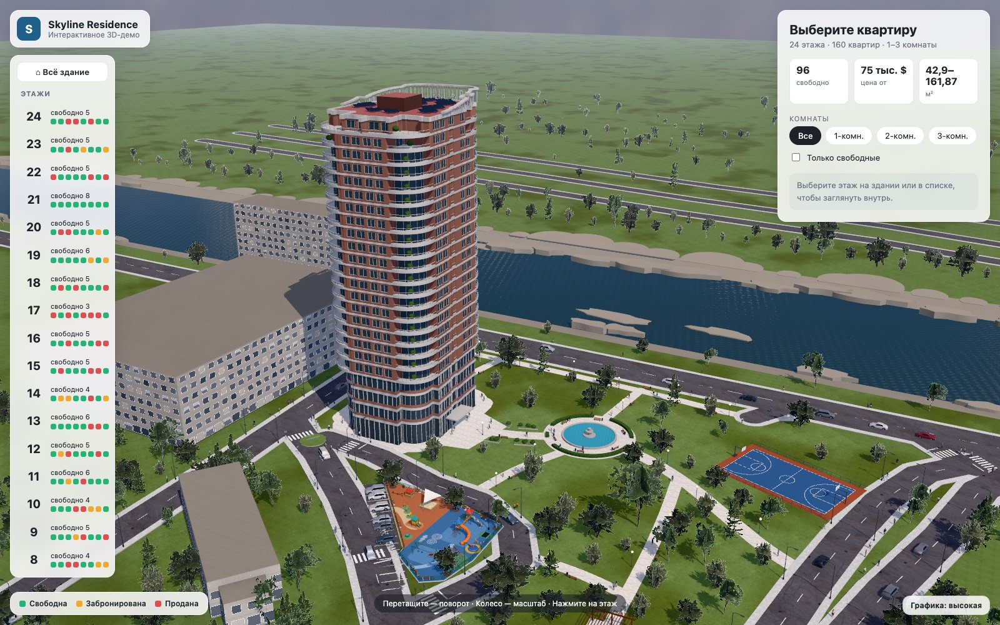
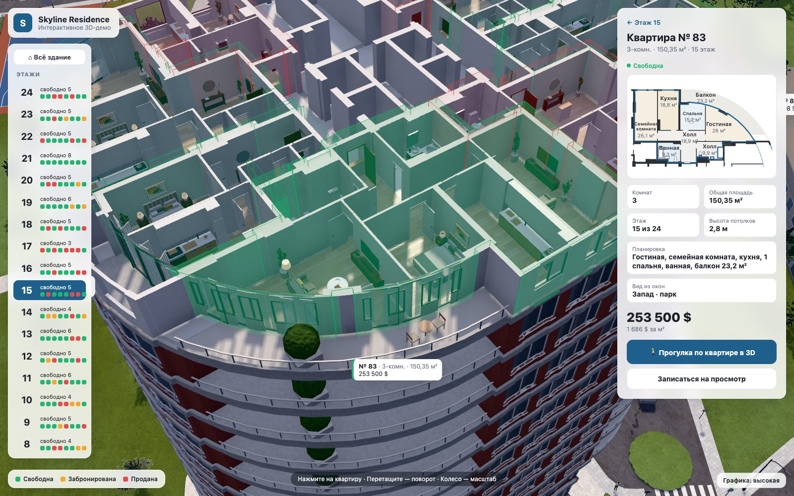
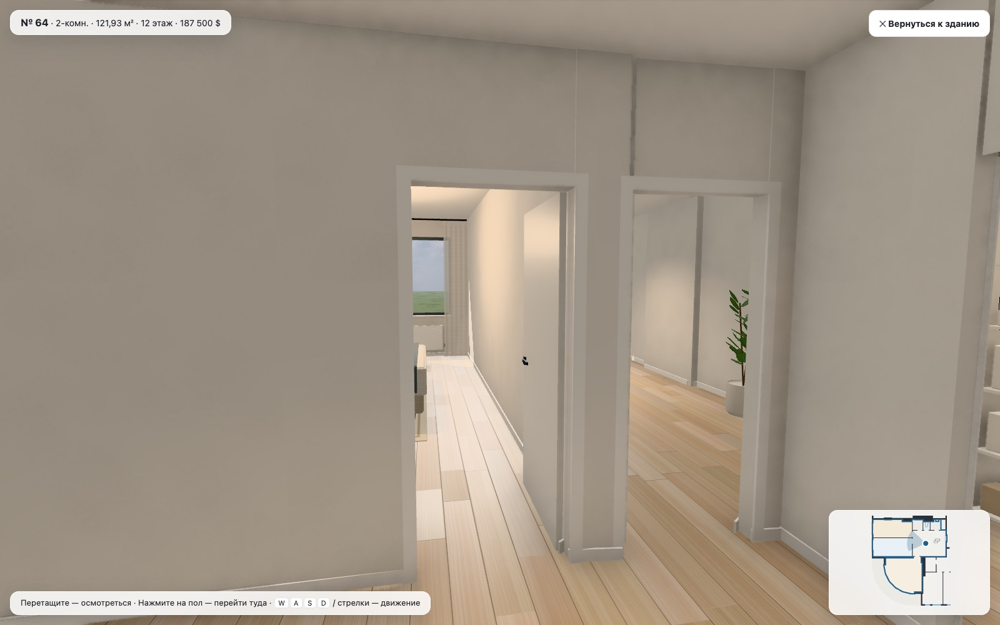
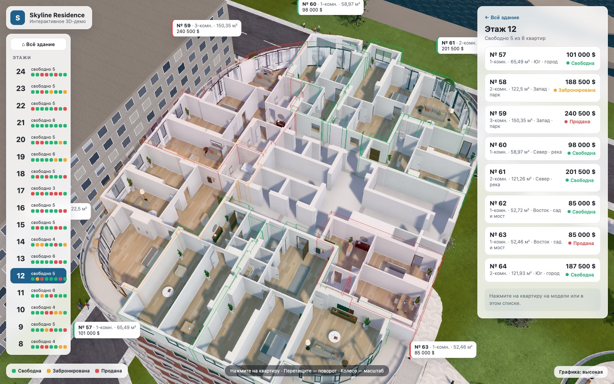
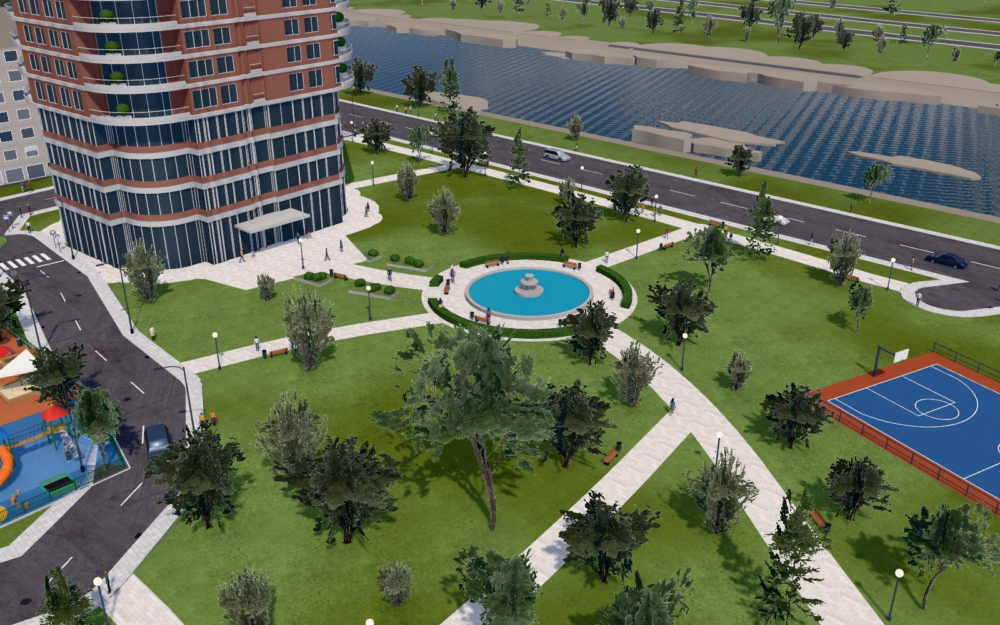

# Skyline Residence – one-tower 3D demo

An interactive 3D sales website (in Russian) for a single residential tower: the customer turns the building
around, hovers a floor to see how many flats are free, opens a floor as a furnished cut-away, picks
an apartment (floor plan, area, view, price) and walks around inside it.

**Live demo:** https://nurovvv.github.io/shahrofar-tower/



| | |
|---|---|
|  |  |
|  |  |

The building is block V of the Shahrofar riverside complex (the full three-tower version is in
[shahrofar-3d](https://github.com/nurovvv/shahrofar-3d)), standing on its own in a landscaped
garden. Built with [Three.js](https://threejs.org) and [Vite](https://vitejs.dev).

## What's in it

| | |
|---|---|
| Building | 24 floors: lobby levels 1–4, apartments on 5–24 (8 per floor, 160 in all, 1–3 rooms, 43–162 m²), terraces on 23–24 |
| Apartments, rooms, walls, windows, balconies | the architect's floor plans: typical floor (sheet 7), floors 23–24 (sheet 8) |
| Floor levels | section 1-1 (sheet 13): floor 5 at +18.6, then 3.3 m per floor; roof at +84.9 |
| Garden | `blender/complex/garden.py`: paved forecourt and entrance canopy, promenade and paths, a round pool with a fountain, a basketball court, a pergola, planted beds, park lamps, benches, trees |
| Surroundings | river, bridge avenue, local roads with markings and street lights, the playground by the car park, parked and moving cars, people |
| Prices and sold/reserved statuses | demo values in `src/data.js` |

Interiors are fitted out in the browser from the floor plans (`src/floor.js`, `src/interior/`):
doors, skirting, tiled bathrooms with fittings, kitchens and furniture against free walls, curtains,
lamps; every room stays reachable on foot.

## Controls

- **Building:** drag to rotate, scroll to zoom, hover the building to see each floor, click a floor
  (or pick one from the list), then click an apartment. Filter by rooms or show available only.
- **Inside:** drag to look around, click the floor to walk there, or use WASD / arrow keys. On touch
  screens, use the on-screen joystick. Esc goes back.
- **Graphics** (bottom right) switches between full quality and a light mode for phones and older
  computers.

## Run locally

```bash
npm install
npm run dev
```

Then open http://localhost:5173.

## Publish

Every push to `main` is built and published to GitHub Pages by `.github/workflows/deploy.yml`
(repository settings → Pages → Source: GitHub Actions).

## Rebuilding the model

```bash
pip install bpy shapely pymupdf      # Blender as a Python module (Python 3.13); or have a Blender 4.2+ binary on PATH
blender/plans/make_plans.sh SET.pdf  # only when the drawings change: PDF -> blender/plans/plans.json
blender/export_web.sh                # -> public/models/shahrofar.glb, src/model/complex.json, src/model/plans.json
```

- `blender/build_complex.py` builds the tower (`complex/drawn.py`, from the plans) and the site
  (`complex/site.py`, `complex/garden.py`, `complex/street.py`).
- `node tools/check_app.mjs` runs the app checks (every flat pickable, floor views, walking
  through flats); `node tools/shots.mjs build/shots` takes the screenshots in `docs/` from fixed
  cameras (`tools/views.mjs`). Both drive the installed Google Chrome against a running dev server.

Third-party textures, sky and trees are CC0 (Poly Haven); see `ASSETS.md`.
